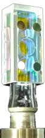
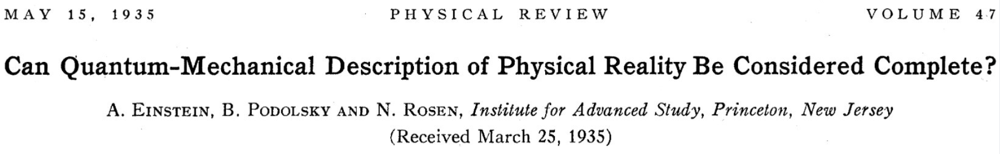
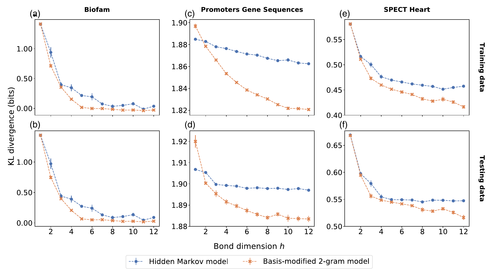
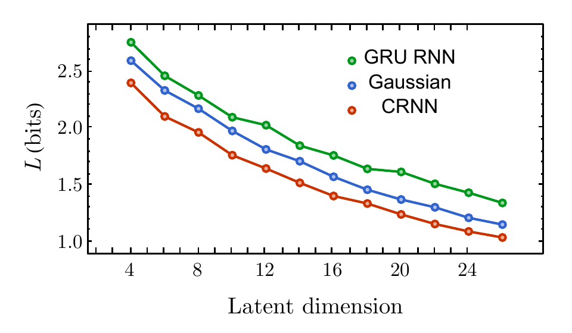

## What we do {#infleqtion-introduction}

```{=html}
<div class="slide-body portfolio-body">
  <div class="portfolio-hero">
    <p class="portfolio-eyebrow">What we do</p>
    <picture class="portfolio-brand"></picture>
    <p class="portfolio-statement">We design, build, and sell <span>quantum computers, precision sensors, and software</span> to governments, corporations, and research institutions</p>
  </div>
  <div class="portfolio-grid">
    <div class="portfolio-domain portfolio-core">
      <h3>Core</h3>
      <div class="portfolio-card">
        <p class="portfolio-description core-description">Infleqtion’s<br>neutral atom<br>core</p>
        
      </div>
    </div>
    <div class="portfolio-domain portfolio-compute">
      <h3>Compute</h3>
      <div class="portfolio-card">
        
        <p class="portfolio-description compute-description">Neutral atom<br>quantum computer</p>
        
        <p class="portfolio-caption">High-performance<br>processing units</p>
      </div>
    </div>
    <div class="portfolio-domain portfolio-sensing">
      <h3>Sensing</h3>
      <div class="portfolio-sensing-grid">
        <div class="portfolio-card">
          
          <p class="portfolio-description">Next-generation<br>atomic clock</p>
          
          <p class="portfolio-caption">GPS-independent,<br>ultra-stable timing</p>
        </div>
        <div class="portfolio-card">
          
          <p class="portfolio-description">Compact<br>quantum RF receiver</p>
          
          <p class="portfolio-caption">Full-spectrum<br>signals intelligence</p>
        </div>
        <div class="portfolio-card">
          
          <p class="portfolio-orbit-label">First in Earth’s Orbit</p>
          <p class="portfolio-description">Quantum inertial<br>sensing</p>
          
          <p class="portfolio-caption">Precision motion<br>and gravity sensing</p>
        </div>
      </div>
    </div>
    <div class="portfolio-domain portfolio-software">
      <h3>Software</h3>
      <div class="portfolio-card">
        
        <p class="portfolio-description software-line">Contextual Machine<br>Learning</p>
        <p class="portfolio-description software-line">Quantum App<br>Development</p>
        
      </div>
    </div>
  </div>
  <p class="portfolio-closing">The only full-spectrum quantum company</p>
</div>
<button type="button" class="career-qr" aria-haspopup="dialog" aria-label="Enlarge QR code for summer internship applications">
  
</button>
```

## Plan {#two-parts}

::: {.slide-body}
::: {.part-overview}
::: {.part-card}
```{=html}
<h3>Part 1: Quantum contextuality</h3>
```

*(intended for beginners)*

- Introduce a fundamental property of quantum theory known as quantum contextuality
:::

::: {.part-card}
```{=html}
<h3>Part 2: Efficient latent space representations from quantum contextuality</h3>
```

(assumes familiarity with conventional notation for 2-qubit states)

- Will build upon part 1 and show that quantum contextuality can be a powerful resource for quantum advantage in machine learning tasks
- Argue that Mermin-Peres magic square correlations may be useful for representing long-context relationships
:::
:::
:::

::: {.notes}
References:

- Simon Kochen and Ernst Specker (1968), [The Problem of Hidden Variables in Quantum Mechanics](https://doi.org/10.1512/iumj.1968.17.17004)
- N. David Mermin (1990), [Simple Unified Form for the Major No-Hidden-Variables Theorems](https://doi.org/10.1103/PhysRevLett.65.3373)

- Gao et al. (2022), [Enhancing Generative Models via Quantum Correlations](https://doi.org/10.1103/PhysRevX.12.021037)
- Anschuetz et al. (2023), [Interpretable Quantum Advantage in Neural Sequence Learning](https://doi.org/10.1103/PRXQuantum.4.020338)
- Teo et al. (2025), [$k$-Contextuality as a Heuristic for Memory Separations in Learning](https://doi.org/10.1109/QCE65121.2025.00260)
- Anschuetz and Gao (2026), [Arbitrary Polynomial Separations in Trainable Quantum Machine Learning](https://doi.org/10.22331/q-2026-01-20-1976)
- Eric R. Anschuetz, [Contextuality for Quantum Advantage Tutorial](https://eanschuetz.github.io/assets/pdfs/tutorials/Contextuality_for_Quantum_Advantage_Tutorial.pdf)
:::

# Part 1: Quantum contextuality {#part-1 .chapter-divider}


## Setup {#setup}

```{=html}
<div class="slide-body setup-body">
<div class="setup-stage" role="img" aria-label="A bag of trinkets branches into eight combinations of color, shape, and pattern">
<div class="setup-bag">
<svg class="setup-bag-back" viewBox="0 0 520 380" aria-hidden="true"><defs><linearGradient id="setup-bag-fabric" x2="1" y2="1"><stop stop-color="#263d86"/><stop offset="1" stop-color="#131a5d"/></linearGradient><linearGradient id="setup-bag-rim" x2="0" y2="1"><stop stop-color="#4565a5"/><stop offset="1" stop-color="#1a2c69"/></linearGradient></defs><path d="M91 105 Q260 52 429 105 L454 299 Q450 348 260 359 Q70 348 66 299Z" fill="url(#setup-bag-fabric)"/><ellipse cx="260" cy="104" rx="171" ry="49" fill="#09163b"/><ellipse cx="260" cy="93" rx="176" ry="44" fill="none" stroke="url(#setup-bag-rim)" stroke-width="21"/></svg>
<div class="setup-bag-fill" aria-hidden="true"><span></span><span></span><span></span><span></span><span></span><span></span><span></span></div>
<svg class="setup-bag-front" viewBox="0 0 520 380" aria-hidden="true"><path d="M81 145 Q260 184 439 145 L454 299 Q450 348 260 359 Q70 348 66 299Z" fill="url(#setup-bag-fabric)"/><path d="M83 145 Q260 184 437 145" fill="none" stroke="#5874ad" stroke-width="12" stroke-linecap="round"/><path d="M107 179 Q97 257 137 318 M413 179 Q423 257 383 318" fill="none" stroke="#7390bd" stroke-opacity=".28" stroke-width="9" stroke-linecap="round"/><path d="M205 239 Q260 267 315 239" fill="none" stroke="#f2b962" stroke-width="6" stroke-linecap="round"/><circle cx="224" cy="246" r="7" fill="#f2b962"/><circle cx="296" cy="246" r="7" fill="#f2b962"/><path d="M224 246 Q194 283 202 316 M296 246 Q326 283 318 316" fill="none" stroke="#f2b962" stroke-width="6" stroke-linecap="round"/></svg>
</div>
</div>
</div>
<div class="slide-side-panel setup-panel">
<p class="setup-intro">We've looted a bag of trinkets.</p>
<table class="setup-properties" aria-label="Trinket property values"><thead><tr><th scope="col">Property</th><th scope="col"></th><th scope="col"></th></tr></thead><tbody>
<tr data-setup-row="color"><th scope="row">Color <span class="math-variable">X</span></th><td><span class="setup-swatch orange"></span>Orange</td><td><span class="setup-swatch teal"></span>Teal</td></tr>
<tr data-setup-row="shape"><th scope="row">Shape <span class="math-variable">Y</span></th><td><span class="setup-swatch square"></span>Square</td><td><span class="setup-swatch circle"></span>Circle</td></tr>
<tr data-setup-row="pattern"><th scope="row">Pattern <span class="math-variable">Z</span></th><td><span class="setup-swatch plain"></span>Plain</td><td><span class="setup-swatch striped"></span>Striped</td></tr>
<tr data-setup-row="sign" class="setup-sign-row"><th scope="row">Numerical value</th><td class="math-text">−1</td><td class="math-text">+1</td></tr>
</tbody></table>
</div>
<span class="fragment setup-step" aria-hidden="true"></span><span class="fragment setup-step" aria-hidden="true"></span><span class="fragment setup-step" aria-hidden="true"></span><span class="fragment setup-step" aria-hidden="true"></span><span class="fragment setup-step" aria-hidden="true"></span>
```

::: {.notes}
Advance once to pluck a teal circular trinket from the bag. The next three advances split every visible trinket by color, shape, and pattern, producing all eight combinations. The last advance assigns −1 to orange, square, and plain, and +1 to teal, circle, and striped. Previous reverses each step.
:::

## Measurements {#measurements}

We have nine measuring devices, each one answers one of the following questions about a pair of trinkets:

```{=html}
<div class="device-tray slide-table-board" aria-label="Tray of measuring devices">
<div class="tray-table">\[
\begin{array}{c|c|c||c}
\class{tray-entry tray-entry-0}{\text{Color of }1\text{?}} & \class{tray-entry tray-entry-1}{\text{Color of }2\text{?}} & \class{tray-entry tray-entry-2}{\begin{gathered}\text{Same}\\\text{color?}\end{gathered}} & \phantom{=+1} \\ \hline
\class{tray-entry tray-entry-3}{\text{Shape of }2\text{?}} & \class{tray-entry tray-entry-4}{\text{Shape of }1\text{?}} & \class{tray-entry tray-entry-5}{\begin{gathered}\text{Same}\\\text{shape?}\end{gathered}} & \phantom{=+1} \\ \hline
\class{tray-entry tray-entry-6}{\begin{gathered}\text{Color }1\\\text{vs. shape }2\end{gathered}} & \class{tray-entry tray-entry-7}{\begin{gathered}\text{Shape }1\\\text{vs. color }2\end{gathered}} & \class{tray-entry tray-entry-8}{\begin{gathered}\text{Same}\\\text{pattern?}\end{gathered}} & \phantom{=+1} \\ \dhline
\phantom{=+1} & \phantom{=+1} & \phantom{=+1} & 
\end{array}
\]</div>
<button class="tray-device" data-device="0" aria-label="Color of trinket 1"><span class="tray-symbol">\(X_1\)</span></button>
<button class="tray-device" data-device="1" aria-label="Color of trinket 2"><span class="tray-symbol">\(X_2\)</span></button>
<button class="tray-device" data-device="2" aria-label="Same color?"><span class="tray-symbol">\(X_1X_2\)</span></button>
<button class="tray-device" data-device="3" aria-label="Shape of trinket 2"><span class="tray-symbol">\(Y_2\)</span></button>
<button class="tray-device" data-device="4" aria-label="Shape of trinket 1"><span class="tray-symbol">\(Y_1\)</span></button>
<button class="tray-device" data-device="5" aria-label="Same shape?"><span class="tray-symbol">\(Y_1Y_2\)</span></button>
<button class="tray-device" data-device="6" aria-label="Color 1 and shape 2: same signs?"><span class="tray-symbol">\(X_1Y_2\)</span></button>
<button class="tray-device" data-device="7" aria-label="Shape 1 and color 2: same signs?"><span class="tray-symbol">\(Y_1X_2\)</span></button>
<button class="tray-device" data-device="8" aria-label="Same pattern?"><span class="tray-symbol">\(Z_1Z_2\)</span></button>
</div>
<div class="slide-side-panel tray-panel">
<iframe class="tray-example" src="assets/measurement-line.html?lesson=tray" title="Example measurement for the selected device" data-preload></iframe>
</div>
<span class="fragment notation-step" aria-hidden="true" style="position:absolute;width:0;height:0;overflow:hidden"></span>
```

::: {.notes}
Introduce the tray before symbols. Advance once to fade to the symbolic labels; Previous restores the words. The measuring devices stay clickable in both views. Each device returns one sign, not a tuple.
Teal, circle, and striped encode positive one; orange, square, and plain encode negative one.
The lower-left devices compare encoded signs of different properties.
At this stage all properties belong to fixed classical objects. Pattern is independent of color and shape.
:::

## Predict the next answer {#predict-color}

```{=html}
<div class="slide-body lesson-body">
<iframe class="lesson-frame" data-measurement-line src="assets/measurement-line.html?lesson=forward" title="Predict the next answer: classical measurement sequence" data-preload></iframe>
</div>
<div class="line-steps" aria-hidden="true" style="position:absolute; width:0; height:0; overflow:hidden; pointer-events:none"><span class="fragment" data-fragment-index="0"></span><span class="fragment" data-fragment-index="1"></span><span class="fragment" data-fragment-index="2"></span></div>
<script defer src="assets/measurement-line-navigation.js"></script>
```

::: {.notes}
Measure color on each trinket, then pause before the joint answer. The fixed pair has X1 = -1 and X2 = +1, so X1 X2 = -1.
Advance with Right, Space, or the next-slide control. Left or Previous undoes a step. Each advance runs one device. Pause for the prediction before the third advance. After the third measurement, advance to the next slide. Previous-slide navigation rewinds the revealed steps.
:::

## Ask the questions in reverse {#reverse-color}

```{=html}
<div class="slide-body lesson-body">
<iframe class="lesson-frame" data-measurement-line src="assets/measurement-line.html?lesson=reverse" title="Ask the questions in reverse: classical measurement sequence" data-preload></iframe>
</div>
<div class="line-steps" aria-hidden="true" style="position:absolute; width:0; height:0; overflow:hidden; pointer-events:none"><span class="fragment" data-fragment-index="0"></span><span class="fragment" data-fragment-index="1"></span><span class="fragment" data-fragment-index="2"></span></div>
```

::: {.notes}
First establish X1 X2 = -1, then X2 = -1. Ask the audience for X1 before revealing +1. This is a different fixed pair from the preceding example.
Advance with Right, Space, or the next-slide control. Left or Previous undoes a step. Each advance runs one device. Pause for the prediction before the third advance. After the third measurement, advance to the next slide. Previous-slide navigation rewinds the revealed steps.
:::

## Compare different properties {#mixed-properties}

```{=html}
<div class="slide-body lesson-body">
<iframe class="lesson-frame" data-measurement-line src="assets/measurement-line.html?lesson=mixed" title="Compare different properties: classical measurement sequence" data-preload></iframe>
</div>
<div class="line-steps" aria-hidden="true" style="position:absolute; width:0; height:0; overflow:hidden; pointer-events:none"><span class="fragment" data-fragment-index="0"></span><span class="fragment" data-fragment-index="1"></span><span class="fragment" data-fragment-index="2"></span></div>
```

::: {.notes}
Measure X1 = -1 and Y2 = -1, then ask for the product. Equal encoded signs give +1; color and shape are not the same physical property.
Use Next to run each measurement and Previous to undo it. Pause before the third step for the audience prediction. Rewind all steps to reset; advance again to replay.
:::

## Which products can we predict? {#classical-square}

::: {.slide-body}
```{=html}
<script defer src="assets/classical-products.js"></script>
<div class="classical-products" aria-label="Classical measurement products">
\[
\begin{array}{c|c|c||c}
X_1 & X_2 & X_1 X_2 & \class{product-slot product-r1}{\rlap{\class{product-question}{\phantom{=} ?}}\class{product-answer}{=+1}} \\ \hline
Y_2 & Y_1 & Y_1 Y_2 & \class{product-slot product-r2}{\rlap{\class{product-question}{\phantom{=} ?}}\class{product-answer}{=+1}} \\ \hline
X_1 Y_2 & Y_1 X_2 & Z_1 Z_2 & \class{product-slot product-r3}{\rlap{\class{product-question}{\phantom{=} ?}}\class{product-answer}{=+1}} \\ \dhline
\class{product-slot product-c1}{\rlap{\class{product-question}{\phantom{=} ?}}\class{product-answer}{=+1}} & \class{product-slot product-c2}{\rlap{\class{product-question}{\phantom{=} ?}}\class{product-answer}{=+1}} & \class{product-slot product-c3}{\rlap{\class{product-question}{\phantom{=} ?}}\class{product-answer}{=+1}} & 
\end{array}
\]
</div>
```
:::

::: {.notes}
Click the first two row products and the first two column products to reveal positive one.
Click a revealed product again to restore its question mark.
The third row and third column remain unknown because pattern is an independent classical property.
:::

## Empirical correlations {#empirical-correlations}

::: {.slide-body .slide-body-start}
**Let's do some [measurements]{.reveal-term}**

```{=html}
<link rel="stylesheet" href="assets/empirical-lab-prototype.css">
<script type="module" src="assets/empirical-lab-prototype.js"></script>
<div class="empirical-lab">
<div class="empirical-factory"></div>
<div class="empirical-results">
<div class="empirical-products" aria-label="Empirical measurement correlations">
\[
\begin{array}{c|c|c||c}
X_1 & X_2 & \class{empirical-context empirical-column}{X_1 X_2} & =+1 \\ \hline
Y_2 & Y_1 & \class{empirical-context empirical-column}{Y_1 Y_2} & =+1 \\ \hline
\class{empirical-context empirical-row}{X_1 Y_2} & \class{empirical-context empirical-row}{Y_1 X_2} & \class{empirical-context empirical-shared}{Z_1 Z_2} & \class{empirical-result-row empirical-row}{\rlap{\class{empirical-question}{\phantom{=} ?}}\class{empirical-answer empirical-context empirical-row}{=+1}} \\ \dhline
=+1 & =+1 & \class{empirical-result-column empirical-column}{\rlap{\class{empirical-question}{\phantom{=} ?}}\class{empirical-answer empirical-context empirical-column}{=-1}} &
\end{array}
\]
</div>
<div class="empirical-counters" aria-label="Number of measured pairs"></div>
</div>
</div>
<span class="fragment empirical-step" aria-hidden="true"></span>
```
:::

::: {.notes}
Next starts the precomputed forked-conveyor prototype. Previous cancels and resets every pair, device permutation, counter, and product. Re-entering after leaving resumes the paused run. Each context cycles through all six permutations; the first two outcomes are random and the third is determined by the joint projective measurement history. The source is a maximally mixed pair on each run. The notebook cat and conveyor are illustrative. Recompute playback with node scripts/precompute-empirical.mjs.
“Any order” refers to permutations within each measured row or column, not arbitrary interleaving of incompatible contexts. This introduces the stipulated observations of the trinket thought experiment; the slide does not report a physical experiment performed for this deck. These correlations cannot come from the fixed classical properties assumed on the preceding slide.
:::

## Can you satisfy all six constraints? {#sign-game transition="none"}

```{=html}
<iframe
  class="sign-game-frame"
  src="assets/sign-game.html"
  title="Interactive Mermin–Peres sign game"
  data-preload
></iframe>
```

::: {.notes}
Begin with an empty board. Ask students to press Randomize and try individual
sign changes before advancing.
:::


## Don't worry if you got the answer wrong… {#einstein-joke}

::: {.slide-body .einstein-joke-body}
[{fig-alt="Physical Review masthead from May 15, 1935, for ‘Can Quantum-Mechanical Description of Physical Reality Be Considered Complete?’ by A. Einstein, B. Podolsky, and N. Rosen."}](https://doi.org/10.1103/PhysRev.47.777)

::: {.fragment .einstein-punchline}
So did Einstein!
:::

::: {.einstein-references}
- A. Einstein, B. Podolsky, and N. Rosen, [*Phys. Rev.* **47**, 777 (1935)](https://doi.org/10.1103/PhysRev.47.777)
- S. Kochen and E. Specker, [*Indiana Univ. Math. J.* **17**, 59 (1968)](https://doi.org/10.1512/iumj.1968.17.17004)
- N. D. Mermin, [*Phys. Rev. Lett.* **65**, 3373 (1990)](https://doi.org/10.1103/PhysRevLett.65.3373)
:::
:::


## Why is it impossible? {#sign-proof transition="none"}



::: {.square-proof .slide-side-panel}
::: {.fragment fragment-index="0"}
- **Assume fixed, pre-existing values.**
- Let $Z_1Z_2=m$, with $m\in\{+1,-1\}$.
:::

::: {.fragment .proof-equations-source fragment-index="1"}
- The highlighted row and column require

  $$\begin{aligned}
  (\class{proof-atom proof-a-X1}{X_1}\class{proof-atom proof-a-Y2}{Y_2})(\class{proof-atom proof-a-Y1}{Y_1}\class{proof-atom proof-a-X2}{X_2})\,\class{proof-atom proof-a-m}{m} &\class{proof-atom proof-a-result}{= +1},\\
  (\class{proof-atom proof-b-X1}{X_1}\class{proof-atom proof-b-X2}{X_2})(\class{proof-atom proof-b-Y1}{Y_1}\class{proof-atom proof-b-Y2}{Y_2})\,\class{proof-atom proof-b-m}{m} &\class{proof-atom proof-b-result}{= -1}.
  \end{aligned}$$
:::

::: {.fragment .proof-equations-target fragment-index="2"}
- Reordering these fixed scalar values gives

  $$\begin{cases}
  (\class{proof-atom proof-a-X1}{X_1}\class{proof-atom proof-a-Y1}{Y_1}\class{proof-atom proof-a-X2}{X_2}\class{proof-atom proof-a-Y2}{Y_2})\,\class{proof-atom proof-a-m}{m} \class{proof-atom proof-a-result}{= +1},\\
  (\class{proof-atom proof-b-X1}{X_1}\class{proof-atom proof-b-Y1}{Y_1}\class{proof-atom proof-b-X2}{X_2}\class{proof-atom proof-b-Y2}{Y_2})\,\class{proof-atom proof-b-m}{m} \class{proof-atom proof-b-result}{= -1}.
  \end{cases}$$
:::

::: {.fragment fragment-index="3"}
- **Contradiction.** The same product cannot have opposite signs. These correlations rule out fixed, <span class="fragment custom context-emphasis" data-fragment-index="4" data-text="context-independent"><span>context-independent</span></span> values.
:::
:::


::: {.notes}
Reuse the empirical correlation table, with the third row and third column highlighted.
The equations enter in reading order; the next step carries each scalar to its matching position in the reordered equations. Advance once per proof step, then emphasize “context-independent.” The next slide connects the square to qubit measurements.
Here the symbols denote hypothetical pre-existing scalar outcomes, not Pauli operators.
The first two row and column constraints identify the composite cells with products of those scalar values. Let the bottom-right value be m; it is shared by both highlighted contexts.
Scalar values commute, so the two highlighted equations have identical left-hand sides after reordering. This step would not be valid for arbitrary noncommuting quantum operators.
The contradiction rules out a shared fixed-value table; it is not yet a memory bound.
This is the two-context version of the parity argument in docs/examples/mermin-peres-square.md, following the supplied notes.
:::


## The Reveal {#the-reveal transition="none"}



::: {.slide-side-panel}
- [**Replace the trinkets with qubits**]{.reveal-term} and interpret $X$, $Y$, and $Z$ as spin measurements along the $x$-, $y$- and $z$- axes.
- These “magic” correlations are exactly what quantum mechanics predicts when we measure each row or column on the two qubits.
- The correlation pattern is known as the [**Mermin–Peres Magic Square**]{.reveal-term} ([Mermin, 1990](https://doi.org/10.1103/PhysRevLett.65.3373)). It illustrates a fundamental property of quantum mechanics called [**quantum contextuality**]{.reveal-term}.
:::

## Why "contextuality"? {#contextuality-square transition="none"}

::: {.slide-board .slide-table-board .proof-table}
::: {.empirical-products .proof-symbol-table}
$$
\begin{array}{c|c|c||c}
\class{proof-slot-0}{X_1} & \class{proof-slot-1}{X_2} & \class{proof-slot-2}{\class{proof-context}{X_1 X_2}} & \class{proof-slot-3}{=+1} \\ \hline
\class{proof-slot-4}{Y_2} & \class{proof-slot-5}{Y_1} & \class{proof-slot-6}{\class{proof-context}{Y_1 Y_2}} & \class{proof-slot-7}{=+1} \\ \hline
\class{proof-slot-8}{\class{proof-context}{X_1 Y_2}} & \class{proof-slot-9}{\class{proof-context}{Y_1 X_2}} & \class{proof-slot-10}{\class{proof-context}{Z_1 Z_2}} & \class{proof-slot-11}{\class{proof-context}{=+1}} \\ \dhline
\class{proof-slot-12}{=+1} & \class{proof-slot-13}{=+1} & \class{proof-slot-14}{\class{proof-context}{=-1}} &
\end{array}
$$
:::

::: {.empirical-products .proof-number-table}
$$
\begin{array}{c|c|c||c}
\class{proof-slot-0}{1} & \class{proof-slot-1}{1} & \class{proof-slot-2}{\class{proof-third-column}{1}} & \class{proof-slot-3}{=+1} \\ \hline
\class{proof-slot-4}{1} & \class{proof-slot-5}{1} & \class{proof-slot-6}{\class{proof-third-column}{1}} & \class{proof-slot-7}{=+1} \\ \hline
\class{proof-slot-8}{\class{proof-third-row}{1}} & \class{proof-slot-9}{\class{proof-third-row}{1}} & \class{proof-slot-10}{\class{proof-third-row proof-third-column}{1}} & \class{proof-slot-11}{\class{proof-satisfied}{=+1}} \\ \dhline
\class{proof-slot-12}{=+1} & \class{proof-slot-13}{=+1} & \class{proof-slot-14}{\class{proof-unsatisfied}{\cancel{=-1}}} &
\end{array}
$$
:::

::: {.empirical-products .proof-negative-table}
$$
\begin{array}{c|c|c||c}
\class{proof-slot-0}{1} & \class{proof-slot-1}{1} & \class{proof-slot-2}{\class{proof-third-column}{1}} & \class{proof-slot-3}{=+1} \\ \hline
\class{proof-slot-4}{1} & \class{proof-slot-5}{1} & \class{proof-slot-6}{\class{proof-third-column}{1}} & \class{proof-slot-7}{=+1} \\ \hline
\class{proof-slot-8}{\class{proof-third-row}{1}} & \class{proof-slot-9}{\class{proof-third-row}{1}} & \class{proof-slot-10}{\class{proof-third-row proof-third-column}{-1}} & \class{proof-slot-11}{\class{proof-unsatisfied}{\cancel{=+1}}} \\ \dhline
\class{proof-slot-12}{=+1} & \class{proof-slot-13}{=+1} & \class{proof-slot-14}{\class{proof-satisfied}{=-1}} &
\end{array}
$$
:::
:::


```{=html}
<span class="fragment proof-fill-step" data-fragment-index="0" aria-hidden="true"></span>
<span class="fragment proof-row-step" data-fragment-index="1" aria-hidden="true"></span>
<span class="fragment proof-column-step" data-fragment-index="2" aria-hidden="true"></span>
```

::: {.context-assignment .context-assignment-row .slide-side-panel}
$Z_1Z_2=+1$ when we measure it with $X_1Y_2$ and $Y_1X_2$.
:::

::: {.context-assignment .context-assignment-column .slide-side-panel}
$Z_1Z_2=-1$ when we measure it with $X_1X_2$ and $Y_1Y_2$.
:::

::: {.fragment .context-quote .slide-side-panel fragment-index="3"}
> In some sense, the “correct” way to do this classically would be to e.g. assign the value $1$ to $Z_1Z_2$ when measuring it with $X_1Y_2$ and $Y_1X_2$, then assign it $-1$ when measuring it with $X_1X_2$ and $Y_1Y_2$. This is why this phenomenon is called contextuality—the measurement result of a given observable depends on other observables that were previously measured.
:::

::: {.notes}
The assignment is an illustrative context-dependent classical model, not a claim that quantum outcomes are predetermined by the measurement context. The displayed signs assume the other four relevant values are $+1$. Advance through the three square states, then reveal the adapted explanation. Previous reverses each step.
:::

# Part 2: Efficient latent space representations from quantum contextuality {#part-2 .chapter-divider}

## This is cute, but what does it have to do with machine learning? {#machine-learning-transition}

## {#machine-learning-conjecture}

::::: {.slide-body}
:::: {.machine-learning-prompt}
::: {.fragment .machine-learning-assumption}
Let\'s conjecture that these \"contextual\" correlations could be useful at representing contextual relationships in classical data.
:::

::: {.fragment .machine-learning-question}
If this is true, is there any advantage to simulating magic square statistics with a quantum computer?
:::

::: {.fragment .machine-learning-question}
Clearly, a quantum computer can simulate these statistics with 2 qubits.
:::

::: {.fragment .machine-learning-question}
***How many classical bits would it take?***
:::
::::
:::::

## A language example {#language-example auto-animate="true" auto-animate-id="language" auto-animate-unmatched="false"}

::: {.slide-body}
```{=html}
<table class="language-table">
  <thead>
    <tr><th scope="col">Contextual history</th><th scope="col">Correct answer</th></tr>
  </thead>
  <tbody>
    <tr>
      <td><div class="language-history"><span>1.</span><span data-id="phone-history">I bought a <strong>phone</strong> yesterday.</span></div></td>
      <td><span class="fragment" data-fragment-index="1">computer or printer</span></td>
    </tr>
    <tr>
      <td><div class="language-history"><span>2.</span><span>I bought a <strong>computer</strong> yesterday.</span></div></td>
      <td><span class="fragment" data-fragment-index="1">phone or printer</span></td>
    </tr>
    <tr>
      <td><div class="language-history"><span>3.</span><span>I bought a <strong>printer</strong> yesterday.</span></div></td>
      <td><span class="fragment" data-fragment-index="1">phone or computer</span></td>
    </tr>
  </tbody>
</table>
<div class="language-query fragment" data-fragment-index="0">
  <strong>Query</strong>
  <em>Which one of the objects did you <strong>NOT</strong> purchase yesterday: <span>a phone, a computer, a printer?</span></em>
</div>
```
:::

## Compressing the context {#language-compression auto-animate="true" auto-animate-id="language" auto-animate-unmatched="false"}

::: {.slide-body}
::: {.compression-diagram}
```{=html}
<div class="compression-history"><span data-id="phone-history">I bought a <strong>phone</strong> yesterday.</span></div>
<div class="compression-history fragment" data-fragment-index="0"><span>Yesterday, I bought a <strong>phone</strong>.</span></div>
<div class="compression-history fragment" data-fragment-index="0"><span>On November 20, I bought a <strong>phone</strong>… today is November 21st.</span></div>
<div class="compression-history fragment" data-fragment-index="2"><span>Yesterday, I bought a <strong>computer</strong>.</span></div>
<div class="compression-history fragment" data-fragment-index="2"><span>24 hours ago I purchased a <strong>printer</strong>.</span></div>
<svg class="compression-arrows" viewBox="0 0 360 560" preserveAspectRatio="none" aria-hidden="true">
  <path class="fragment" data-fragment-index="1" d="M 8 56 C 170 56, 185 168, 300 168 M 8 168 H 350 M 8 280 C 170 280, 185 168, 300 168 M 330 151 L 350 168 L 330 185" />
  <path class="fragment" data-fragment-index="2" d="M 8 392 C 200 392, 224 208, 350 208 M 330 191 L 350 208 L 330 225 M 8 504 C 175 504, 230 233, 350 233 M 330 216 L 350 233 L 330 250" />
  <path class="compression-cross fragment" data-fragment-index="3" d="M 181 278 L 227 324 M 227 278 L 181 324 M 125 397 L 171 443 M 171 397 L 125 443" />
</svg>
```

::: {.compression-state .fragment fragment-index="1"}
Example internal state

Classical $\psi_1 = 101$

Quantum $\ket{\psi_1} = \ket{++}$
:::
:::

::: {.compression-takeaway}
::: {.fragment fragment-index="1"}
- All three phone histories can share one internal state and still yield **computer or printer**.
:::

::: {.fragment fragment-index="2"}
- However, we don't want to compress *different* histories into the same internal state in case we need to distinguish them later
:::
:::
:::

## A recurrent model in action {#recurrent-model-animation}

```{=html}
<div class="slide-body">
  <iframe class="lesson-frame recurrent-frame" src="assets/recurrent-model/device.html" title="Recurrent model conveyor animation" tabindex="-1" data-preload></iframe>
</div>
<div class="recurrent-steps" aria-hidden="true">
  <span class="fragment"></span>
  <span class="fragment"></span>
  <span class="fragment"></span>
</div>
<script defer src="assets/recurrent-model/navigation.js"></script>
```

::: {.notes}
Each advance processes one complete message. The cat first emits $y_t$ from its current memory $\lambda_{t-1}$, then updates to $\lambda_t$. Starting from $00$, “I bought a phone yesterday” emits “phone” and changes the memory to $01$. The filler text and the final query each emit “computer” and leave the memory at $01$. The output depends only on the state before the update: $00$ yields “phone”, $01$ yields “computer”, and $10$ yields “printer”. Previous restores the preceding message, output, and memory state.
:::


## Very weak simulation of the magic square {#classical-square-simulation data-transition="fade-in none-out"}

::: {.classical-simulation-requirement}
Only requirement: no impossible measurement outcomes
:::

:::: {.slide-body .slide-table-board .classical-simulation-board}


::: {.classical-state-map}
::: {.classical-state-map-title}
Classical encoding (internal states)
:::

```{=html}
<div class="encoding-pairings" data-step="0">
  <div class="encoding-x">
    <div>\(\lvert ++\rangle \rightarrow 00\)</div>
    <div>\(\lvert +-\rangle \rightarrow 01\)</div>
    <div>\(\lvert -+\rangle \rightarrow 10\)</div>
    <div>\(\lvert --\rangle \rightarrow 11\)</div>
  </div>
</div>
```
:::
::::

::: {.slide-side-panel .classical-simulation-panel}
```{=html}
<iframe class="lesson-frame recurrent-frame" src="assets/recurrent-model/measurement.html" title="Classical recurrent model simulating measurements" tabindex="-1" data-preload></iframe>
```
:::

```{=html}
<div class="recurrent-steps" aria-hidden="true">
  <span class="fragment"></span><span class="fragment"></span><span class="fragment"></span>
  <span class="fragment"></span><span class="fragment"></span>
</div>
```

::: {.notes}
The model starts at $00$, encoding the preparation $\lvert ++\rangle$. For $X_1$, $X_2$, and $X_1X_2$ it outputs $+1,+1,-1$. The top row requires product $+1$, so the sequence is impossible.

The second example starts fresh from $00$. The model outputs $+1$ for $X_1$ and mistakenly updates to $01$. It then outputs $-1$ for $X_2$. In the quantum experiment, the first measurement leaves $\lvert ++\rangle$ unchanged, so $X_2$ must give $+1$. Previous reverses each request.
:::

## Very weak simulation of the magic square {#classical-encoding-pairings data-transition="none-in fade-out"}

::: {.classical-simulation-requirement}
Only requirement: no impossible measurement outcomes
:::

:::: {.slide-body .slide-table-board .classical-simulation-board}


::: {.classical-state-map}
::: {.classical-state-map-title}
Classical encoding (internal states)
:::

```{=html}
<div class="encoding-pairings" data-step="0">
  <div class="encoding-y" aria-label="Y-basis states">
    <div class="encoding-y-row encoding-first-row"><span class="encoding-specific-state">\(\lvert +i,+i\rangle\)</span><span class="encoding-general-state">\(\lvert y_1,y_2\rangle\)</span></div>
    <div class="encoding-y-row">\(\lvert +i,-i\rangle\)</div>
    <div class="encoding-y-row">\(\lvert -i,+i\rangle\)</div>
    <div class="encoding-y-row">\(\lvert -i,-i\rangle\)</div>
  </div>
  <div class="encoding-x">
    <div class="encoding-first-row"><span class="encoding-specific-state">\(\lvert ++\rangle \rightarrow 00\)<span class="encoding-zero-error" aria-label="Incompatible">\(\times\)</span></span><span class="encoding-general-state">\(\lvert x_1,x_2\rangle \rightarrow \lambda\)</span></div>
    <div>\(\lvert +-\rangle \rightarrow 01\)</div>
    <div>\(\lvert -+\rangle \rightarrow 10\)</div>
    <div>\(\lvert --\rangle \rightarrow 11\)</div>
  </div>
  <div class="encoding-graph">\(\lvert G\rangle\)<span class="encoding-graph-equation">: \(X_1Y_2\lvert G\rangle = Y_1X_2\lvert G\rangle = Z_1Z_2\lvert G\rangle = +1\lvert G\rangle\)</span></div>
  <div class="encoding-constraints" aria-live="polite">
    <div class="encoding-constraint-one">\(x_1^{\lambda} = y_2^{\lambda}\)</div>
    <div class="encoding-constraint-two">\(,\quad x_2^{\lambda} = y_1^{\lambda}\)</div>
  </div>
</div>
<div class="encoding-steps" aria-hidden="true"><span class="fragment"></span><span class="fragment"></span><span class="fragment"></span><span class="fragment"></span><span class="fragment"></span><span class="fragment"></span><span class="fragment"></span><span class="fragment"></span><span class="fragment"></span><span class="fragment"></span><span class="fragment"></span><span class="fragment"></span><span class="fragment"></span><span class="fragment"></span><span class="fragment"></span><span class="fragment"></span><span class="fragment"></span><span class="fragment"></span><span class="fragment"></span><span class="fragment"></span><span class="fragment"></span><span class="fragment"></span><span class="fragment"></span><span class="fragment"></span><span class="fragment"></span></div>
```
:::
::::

::: {.slide-side-panel .classical-simulation-panel}
```{=html}
<iframe class="lesson-frame recurrent-frame" src="assets/recurrent-model/measurement.html?example=compatible" title="Classical recurrent model simulating measurements" tabindex="-1" data-preload data-encoding-measurements></iframe>
```
:::

```{=html}
<div class="fragment classical-memory-takeaway">You need <em>at least</em> 5 internal states, or 3 bits to simulate this, but quantum computers need only 2 qubits!</div>
```

::: {.notes}
Each two-bit label is shared by one X-basis preparation and one Y-basis preparation. The shuffle shows an alternative pairing before returning to matching signs. Assigning $\lvert ++\rangle$, $\lvert +i,+i\rangle$, and $\lvert G\rangle$ to $00$ forces all nine table entries to $+1$, contradicting the last column. The same argument then applies to arbitrary signs and a shared state $\lambda$.
:::

## How does this advantage scale when we have $n$ qubits? {#qubit-scaling}

## Intuitive argument {#intuitive-scaling-argument}

::: {.slide-body .slide-body-start .scaling-argument}
- How many magic-square configurations arise for $n$ qubits?
- [Gao et al. (2022)](https://doi.org/10.1103/PhysRevX.12.021037) use magic-square contradictions to show that a classical hidden Markov model needs at least $2^{\Omega(n^2)}$ hidden states to simulate the relevant stabilizer measurements.
- Taking $\log_2$, this requires $\Omega(n^2)$ classical bits, compared with $n$ qubits.
:::

::: {.notes}
Gao et al., Section IV C 4 and Appendix D, count stabilizer states and bound how many can share a classical hidden state without encountering a magic-square contradiction. Their Eq. (18) gives $V\ge 2^{n^2/4-O(n)}$; this is a bound on classical hidden states, not a reported count of magic squares. Encoding those states requires $\Omega(n^2)$ classical bits. The paper's Theorem 2 gives a related approximation bound for translation-form HMMs.
:::

## Empirical results {#empirical-sequence-results}

```{=html}
<div class="slide-body empirical-results-body">
  <div class="empirical-results-grid">
    <article class="empirical-result-panel">
      <h3>HMM and basis-enhanced model</h3>
      <p>Biofam, gene sequences, and heart data</p>
      <div class="empirical-result-figure"></div>
      <p class="empirical-result-citation"><a href="https://doi.org/10.1103/PhysRevX.12.021037">Gao et al., <em>Enhancing Generative Models via Quantum Correlations</em>, Phys. Rev. X 12, 021037 (2022), Fig. 13.</a></p>
    </article>
    <article class="empirical-result-panel">
      <h3>Contextual RNN</h3>
      <p>Spanish-to-English translation</p>
      <div class="empirical-result-figure"></div>
      <p class="empirical-result-citation"><a href="https://arxiv.org/abs/2209.14353v1">Anschuetz et al., <em>Interpretable Quantum Advantage in Neural Sequence Learning</em>, arXiv:2209.14353v1 (2022), Fig. 3.</a></p>
    </article>
  </div>
</div>
```

::: {.notes}
Gao et al., Fig. 13, report averages over ten trials; error bars show one standard error. The top and bottom rows show training and test results. The three data sets are Biofam, Promoters Gene Sequences, and SPECT Heart, so not every result is a language sequence task.

Anschuetz et al., arXiv v1 (2022), Fig. 3, report test-set forward empirical cross entropy on Spanish-to-English translation. The contextual and Gaussian models have the same number of trainable parameters; the GRU recurrent cell is within 2.5% at the largest size. These are classical numerical simulations, not measurements on quantum hardware. The final paper appeared in PRX Quantum 4, 020338 (2023), DOI: 10.1103/PRXQuantum.4.020338; its Fig. 3 includes standard deviations across five runs.
:::

## Summary {#summary}

:::: {.slide-body .slide-body-start}
::: {.summary-overview}
::: {.part-card .summary-card}
```{=html}
<h3>Part 1: quantum contextuality</h3>
```

- Compatible measurements can exhibit correlations that no fixed, context-independent assignment of values can reproduce.
- The Mermin–Peres magic square makes this contradiction explicit: its row and column product constraints cannot all be satisfied by fixed signs.
- Quantum measurements on two qubits nevertheless produce the required correlations.
:::

::: {.part-card .summary-card}
```{=html}
<h3>Part 2: Efficient latent space representations from quantum contextuality</h3>
```

- Sequence models must retain distinctions between histories when future observations depend on them.
- For the magic-square simulation, two qubits suffice; a classical model needs at least five internal states, or three bits.
- For the studied family of measurement sequences, the classical memory requirement grows as $\Omega(n^2)$ bits versus $n$ qubits.
- Contextual correlations may help represent long-context relationships; the reported sequence experiments provide empirical motivation.
:::
:::
::::

```{=html}
<button type="button" class="career-qr" aria-haspopup="dialog" aria-label="Enlarge QR code for summer internship applications">
  
</button>
```
